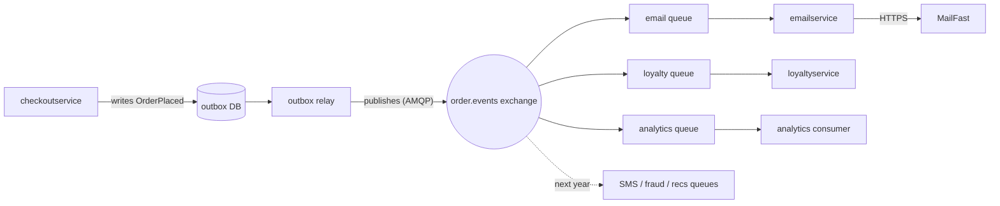

# ADR-0002: Publish an "order placed" event to RabbitMQ for post-order actions

- **Status:** Proposed
- **Date:** 2026-10-26
- **Deciders:** Not evidenced in the provided files (to be confirmed by the team)

## Context and problem

Requirement R-12 (`docs/scenario.md`): after an order is placed, Online Boutique must (1) send the confirmation email through **MailFast** (external), replacing the mock `emailservice` logic; (2) award loyalty points through a new `loyaltyservice`; (3) record an "order placed" analytics event for marketing. More post-order actions are expected next year (SMS, fraud scoring, recommendations update).

How it works today:

- `checkoutservice.PlaceOrder` runs everything **synchronously in sequence** over gRPC: cart, catalog, currency, `chargeCard`, `shipOrder`, `emptyUserCart`, then `sendOrderConfirmation` (`system/online-boutique/src/checkoutservice/main.go`, `PlaceOrder`, L230–280).
- An email failure is only logged as a warning; the order still succeeds (`main.go` L273–277).
- Every downstream service is a hard-wired address read at startup (`mustMapEnv(&svc.emailSvcAddr, "EMAIL_SERVICE_ADDR")`, L111–116). Adding an action today means changing `checkoutService` code, config and deployment.
- The order total is computed locally (L243–250) but is **not** part of `OrderResult` (L265–271), so any consumer that needs the amount (e.g. loyalty points) cannot get it from today's message.
- `checkoutservice` has no data store of its own (not evidenced in `main.go`).

Facts that constrain the decision (`docs/scenario.md`):

| Topic | Fact | Consequence for this decision |
|---|---|---|
| Checkout latency | p95 `PlaceOrder` ≤ 500 ms (today approximately 300 ms) | Only approximately 200 ms of headroom left |
| MailFast | p95 1.5 s, p99 8 s, approximately 0.5 % failures, 50 emails/s rate limit | A synchronous MailFast call alone would break the 500 ms budget |
| Peak load | 200 orders/s (11.11 sale) | Email demand is 4× the MailFast rate limit; approximately 150 emails/s must be buffered at peak |
| Loyalty | within 1 minute, exactly once | Need durable delivery + idempotent processing |
| Availability | an order must never fail because email, loyalty or analytics is down | Post-order actions must be decoupled from the order's success |
| Team | 4 devs, strong Go/gRPC, two have used RabbitMQ | Favours a technology the team already knows |
| Operations | Kubernetes; prefer open-source, self-hosted | Rules out cloud-only managed queues |

## Decision drivers

1. **Availability:** an order must never fail because email, loyalty or analytics is down.
2. **Performance:** keep `PlaceOrder` p95 ≤ 500 ms at 200 orders/s.
3. **Reliability of delivery:** loyalty points exactly once within 1 minute; emails not lost despite MailFast failures and its 50/s rate limit.
4. **Modifiability:** add SMS, fraud scoring and recommendations next year without changing `checkoutservice` each time.
5. **Team fit and operations:** small team (4), Go/gRPC skills, RabbitMQ experience, self-hosted open source on Kubernetes.

## Considered options

1. **Extend the synchronous gRPC chain:** `checkoutservice` calls MailFast (via `emailservice`), `loyaltyservice` and an analytics service one after another inside `PlaceOrder`.
2. **In-process async calls:** `checkoutservice` fires the three calls in goroutines after the order succeeds and returns immediately.
3. **Event-driven with RabbitMQ (self-hosted):** `checkoutservice` publishes one `OrderPlaced` event to a fanout/topic exchange; each action (`emailservice` → MailFast, `loyaltyservice`, analytics) has its own durable queue and consumer.
4. **Event streaming with Apache Kafka (self-hosted):** `checkoutservice` writes `OrderPlaced` to a Kafka topic; each action is a consumer group.

### Pros and cons of the options

| Option | Pros | Cons |
|---|---|---|
| 1. Sync gRPC chain | Simplest; no new infrastructure; matches current code style | MailFast p95 1.5 s alone breaks the 500 ms budget; p99 8 s blocks checkout threads; 50/s rate limit throttles checkout at 200 orders/s; every new action edits `checkoutservice` (poor modifiability) |
| 2. Goroutines | No new infrastructure; checkout latency unaffected | Work is lost if a pod restarts (no durability); retries, rate limiting and dedup must be hand-built per replica; still couples `checkoutservice` to every action |
| 3. RabbitMQ | Checkout only adds one publish; consumers fail independently; durable queues buffer the 150 emails/s peak surplus; per-queue retry / dead-letter; new actions = new queue binding, no checkout change; two devs already know it; open source, self-hosted | New stateful component to run (clustering, quorum queues); at-least-once delivery, so consumers must be idempotent; publish must be confirmed or the event can be lost; no long-term replay for analytics |
| 4. Kafka | High throughput; events kept and replayable (useful for analytics and future consumers like recommendations); consumer groups scale well | Heavier to operate on Kubernetes (brokers, partitions, KRaft/ZooKeeper); throughput far beyond 200 events/s is not needed; still at-least-once unless extra effort, so idempotency still required |

## Decision

Choose **Option 3: publish an `OrderPlaced` event to a self-hosted RabbitMQ**.

- After `shipOrder` succeeds, `checkoutservice` writes one `OrderPlaced` event (protobuf, with `order_id`, `user_id`, `email`, items, shipping cost **and order total**) to the outbox table in a new PostgreSQL database and returns. It replaces the direct `sendOrderConfirmation` call (`main.go` L273–277, L379–384).
- A relay process reads unsent outbox rows, publishes them to RabbitMQ, and marks them as sent, retrying until it succeeds.
- If the relay publishes the same event twice, loyaltyservice ignores it using order_id, so points are awarded exactly once.
- If the outbox write fails, the order fails
- One exchange, one durable queue per action:
  - `email` queue → `emailservice` calls MailFast through a single consumer replica rate-limited to ≤ 50 msgs/s; Kubernetes restarts it on failure while the queue holds pending emails. Retries with backoff, dead-letter queue after N attempts.
  - `loyalty` queue → `loyaltyservice` awards points **idempotently**, using `order_id` as a unique key, so redeliveries never double the points.
  - `analytics` queue → analytics consumer records the event.
- Future actions (SMS, fraud scoring, recommendations) add a queue bound to the same exchange, with no change to `checkoutservice`.

Why: it is the only option that meets drivers 1–4 together while matching the team's existing RabbitMQ experience and the self-hosted preference (driver 5). Kafka would also work but its replay and throughput benefits do not outweigh the extra operations work.

## Consequences

- **Positive:** an order no longer depends on MailFast, `loyaltyservice` or analytics being up (availability).
- **Positive:** `PlaceOrder` adds only one confirmed publish instead of a 1.5 s p95 MailFast call, keeping it inside the 500 ms budget (performance). [Inferred] publish latency is a few ms; to be confirmed by load test.
- **Positive:** queues absorb the 200 orders/s peak while the email consumer respects MailFast's 50/s limit (scalability, reliability).
- **Positive:** new post-order actions are new subscribers, not changes to `checkoutservice` (modifiability).
- **Negative:** RabbitMQ is a new stateful component the 4-person team must run, monitor and upgrade on Kubernetes (operability, cost).
- **Negative:** emails arrive later at peak; a backlog of approximately 150 emails per second of peak builds up and drains after the peak (user-visible latency of the email).
- **Negative:** eventual consistency and harder debugging across async hops; trace context must be carried in message headers to keep the existing OpenTelemetry tracing (`main.go` L134–140) end to end (observability).
- **Risks and mitigations:**
  - *Double loyalty points* (at-least-once delivery) → idempotent consumer keyed by `order_id` with a unique constraint in the loyalty store.
  - *Lost event if RabbitMQ is down at publish time* → publisher confirms + short retry; consider an outbox once checkout has a store; alert on publish failures.
  - *RabbitMQ is a single point of failure for post-order actions* → 3-node cluster with quorum queues and persistent volumes.
  - *MailFast failures (0.5 %) and p99 8 s* → consumer timeout, retries with backoff, dead-letter queue and alerting.
  - *Loyalty misses the 1-minute target* → monitor `loyalty` queue lag; scale `loyaltyservice` replicas.

## Validation

- Load test with the `loadgenerator` at 200 orders/s: `PlaceOrder` p95 ≤ 500 ms, zero orders failing.
- Chaos tests: stop `emailservice`, `loyaltyservice`, the analytics consumer, and MailFast (stubbed) one at a time; orders must still succeed and backlogs must drain after recovery.
- Loyalty: inject duplicate deliveries; points awarded exactly once per `order_id`; 99th-percentile order-to-points time < 60 s at peak.
- Email: consumer rate never exceeds 50/s; dead-letter queue stays empty except for MailFast permanent failures.
- Review this ADR after the first 11.11 sale, and before adding the first new consumer next year.

## Open questions

- **Email delay at peak:** how long may a confirmation email be delayed? The 11.11 peak duration is not given, so the backlog size and drain time (at 50/s) cannot be computed.
- **Event loss tolerance:** is losing a rare `OrderPlaced` event (RabbitMQ down at publish time) acceptable, or is an outbox (and therefore a data store for `checkoutservice`) required?
- **Loyalty rules and store:** how are points calculated (order total? items?) and which data store will `loyaltyservice` use for points and the `order_id` dedup key?
- **Analytics destination:** where must the "order placed" event end up (which tool or database does marketing use), and does it need history/replay? (If yes, Kafka or an event archive becomes more attractive.)
- **MailFast API details:** protocol, auth, whether it supports idempotency keys (to avoid duplicate emails on retry), and whether the 50/s limit can be raised.
- **RabbitMQ operations:** who owns the cluster, and is there budget for 3 nodes and persistent storage?
- **Deciders and date of acceptance:** not given.
