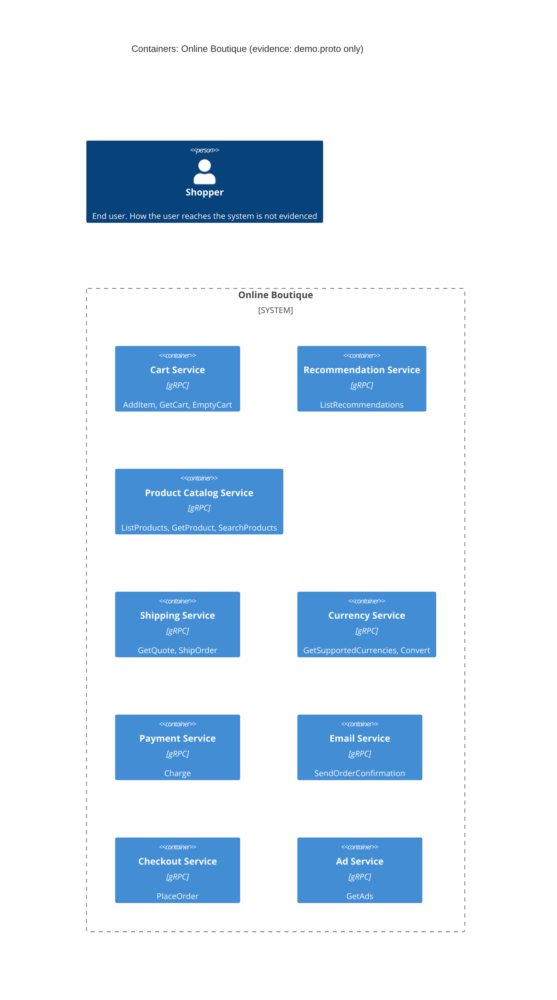

# Task 1A: Recovered architecture (C4 container level)

## 1. Agent

Claude Code (Anthropic), model Claude Opus 5.5 (`claude-opus-5-5`).

## 2. Files read

- `prompts/1-recover-architecture.md` (task file)
- `system/online-boutique/protos/demo.proto` (the only evidence file)

## 3. Containers table

The proto declares nine gRPC services in package `hipstershop` (`demo.proto` line 17). It defines interfaces only. It does not show what language implements each service, how services are deployed, or which data stores they use.

| Container | Technology / language | Responsibility | Evidence |
|---|---|---|---|
| Cart Service | gRPC service (proto3); implementation language: Not evidenced in the provided files | Add items to a user's cart, get the cart, empty the cart (`AddItem`, `GetCart`, `EmptyCart`) | `system/online-boutique/protos/demo.proto` (`service CartService`, lines 23–27) |
| Recommendation Service | gRPC service (proto3); language not evidenced | Return recommended product IDs for a user and a list of product IDs (`ListRecommendations`) | `system/online-boutique/protos/demo.proto` (`service RecommendationService`, lines 56–58) |
| Product Catalog Service | gRPC service (proto3); language not evidenced | List, get and search products (`ListProducts`, `GetProduct`, `SearchProducts`) | `system/online-boutique/protos/demo.proto` (`service ProductCatalogService`, lines 71–75) |
| Shipping Service | gRPC service (proto3); language not evidenced | Quote shipping cost and ship an order, returning a tracking ID (`GetQuote`, `ShipOrder`) | `system/online-boutique/protos/demo.proto` (`service ShippingService`, lines 107–110) |
| Currency Service | gRPC service (proto3); language not evidenced | List supported currencies and convert `Money` between ISO 4217 currencies (`GetSupportedCurrencies`, `Convert`) | `system/online-boutique/protos/demo.proto` (`service CurrencyService`, lines 140–143) |
| Payment Service | gRPC service (proto3); language not evidenced | Charge a credit card for an amount and return a transaction ID (`Charge`) | `system/online-boutique/protos/demo.proto` (`service PaymentService`, lines 177–179) |
| Email Service | gRPC service (proto3); language not evidenced | Send an order confirmation to an email address (`SendOrderConfirmation`) | `system/online-boutique/protos/demo.proto` (`service EmailService`, lines 199–201) |
| Checkout Service | gRPC service (proto3); language not evidenced | Place an order from user ID, currency, address, email and card, returning an `OrderResult` (`PlaceOrder`) | `system/online-boutique/protos/demo.proto` (`service CheckoutService`, lines 224–226) |
| Ad Service | gRPC service (proto3); language not evidenced | Return ads for a set of page context keywords (`GetAds`) | `system/online-boutique/protos/demo.proto` (`service AdService`, lines 243–245) |

Data stores: Not evidenced in the provided files.

## 4. Dependencies table

A `.proto` file declares which RPCs each service **offers**. It does not say who **calls** them, so no caller → callee dependency can be proved from this evidence.

| Caller → callee | Protocol | Evidence |
|---|---|---|
| None evidenced | — | Not evidenced in the provided files. `demo.proto` contains no client or caller information. |

Possible dependencies suggested by shared message types are listed under **Gaps**.

## 5. Mermaid diagram

The diagram shows only what the tables show: nine containers and no relationships. The end user is drawn as a `Person` because the C4 notation requires one, but the evidence shows no UI or entry point for the user, so the user has no `Rel`.

## 6. Gaps

| Gap | What the proto hints at | Extra file that would settle it |
|---|---|---|
| Who calls whom (all runtime dependencies) | **[Inferred]** `PlaceOrderRequest` carries `CreditCardInfo`, `Address` and `email` (lines 228–235), and `OrderResult` holds `shipping_tracking_id` and `shipping_cost` (lines 208–214). This suggests Checkout Service calls Cart, Product Catalog, Currency, Shipping, Payment and Email. Not proved. | `system/online-boutique/kubernetes-manifests/checkoutservice.yaml` (`*_SERVICE_ADDR` env vars) or checkout service source code |
| User-facing entry point (web frontend, HTTP) | None of the nine services is a UI. The user must reach them through some other component that is not in the proto. **[Inferred]** a frontend exists and calls these services. | `system/online-boutique/kubernetes-manifests/frontend.yaml` and the frontend source in `system/online-boutique/src/` |
| Implementation language of each service | `option go_package` (line 19) only names the package for generated Go code. It does not show which services are written in Go. | Per-service source folders / Dockerfiles in `system/online-boutique/src/` |
| Data stores (e.g. where carts are kept) | `Cart` (lines 47–50) is state keyed by `user_id`, so Cart Service probably needs storage. **[Inferred]** Store type not evidenced. | `system/online-boutique/kubernetes-manifests/` (e.g. a cart / Redis manifest) and cart service config |
| External systems (real payment gateway, real email/SMTP provider) | `Charge` and `SendOrderConfirmation` might use outside systems, or they might be mocks. Not evidenced. | Payment service and email service source code |
| Ports, deployment, sync vs async messaging | Only unary gRPC RPCs are declared. There are no streams and no broker. Whether any messaging happens outside gRPC is not evidenced. | `system/online-boutique/kubernetes-manifests/*.yaml` |
