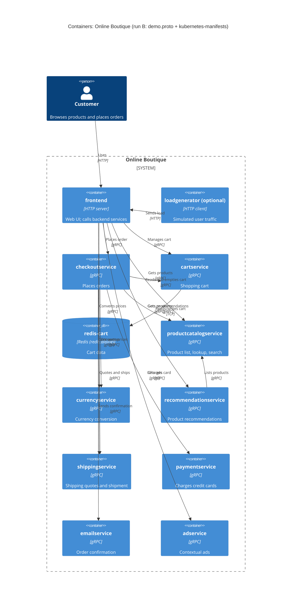

# Task 1 – Recovered C4 container architecture (run B)

## 1. Agent

Claude Code (Anthropic), model Claude Opus 5.5 (`claude-opus-5-5`).

## 2. Files read

- `prompts/1-recover-architecture.md` (task file)
- `system/online-boutique/protos/demo.proto`
- `system/online-boutique/kubernetes-manifests/README.md`
- `system/online-boutique/kubernetes-manifests/kustomization.yaml`
- `system/online-boutique/kubernetes-manifests/adservice.yaml`
- `system/online-boutique/kubernetes-manifests/cartservice.yaml`
- `system/online-boutique/kubernetes-manifests/checkoutservice.yaml`
- `system/online-boutique/kubernetes-manifests/currencyservice.yaml`
- `system/online-boutique/kubernetes-manifests/emailservice.yaml`
- `system/online-boutique/kubernetes-manifests/frontend.yaml`
- `system/online-boutique/kubernetes-manifests/loadgenerator.yaml`
- `system/online-boutique/kubernetes-manifests/paymentservice.yaml`
- `system/online-boutique/kubernetes-manifests/productcatalogservice.yaml`
- `system/online-boutique/kubernetes-manifests/recommendationservice.yaml`
- `system/online-boutique/kubernetes-manifests/shippingservice.yaml`

## 3. Containers table

Implementation language is **not evidenced** for any of the custom services: the manifests only give unqualified image names (e.g. `image: frontend`), and `demo.proto` is language-neutral. The column therefore lists the interface technology the evidence shows.

| Container | Technology / language | Responsibility | Evidence |
|---|---|---|---|
| `frontend` | HTTP server, port 8080; language not evidenced | Web UI for shoppers; calls the backend services. Exposed outside the cluster | `kubernetes-manifests/frontend.yaml` (Service `frontend-external`, `type: LoadBalancer`; port name `http`; `httpGet` probes on `/_healthz`; cookie `shop_session-id`) |
| `cartservice` | gRPC server, port 7070; language not evidenced | Add items, get cart, empty cart per `user_id` | `kubernetes-manifests/cartservice.yaml` (Service port `grpc` 7070); `protos/demo.proto` (`service CartService`) |
| `redis-cart` | Redis (`redis:alpine`), port 6379 | Cart data store for `cartservice`. Data on an `emptyDir` volume, so it is lost when the pod is removed | `kubernetes-manifests/cartservice.yaml` (Deployment `redis-cart`, `image: redis:alpine`, volume `redis-data: emptyDir`) |
| `productcatalogservice` | gRPC server, port 3550; language not evidenced | List, get and search products | `kubernetes-manifests/productcatalogservice.yaml` (port `grpc` 3550); `protos/demo.proto` (`service ProductCatalogService`) |
| `currencyservice` | gRPC server, port 7000; language not evidenced | Supported currencies and money conversion | `kubernetes-manifests/currencyservice.yaml` (port `grpc` 7000); `protos/demo.proto` (`service CurrencyService`) |
| `recommendationservice` | gRPC server, port 8080; language not evidenced | Recommend product IDs for a user and their products | `kubernetes-manifests/recommendationservice.yaml` (port `grpc` 8080); `protos/demo.proto` (`service RecommendationService`) |
| `shippingservice` | gRPC server, port 50051; language not evidenced | Shipping quotes and ship order (returns `tracking_id`) | `kubernetes-manifests/shippingservice.yaml` (port `grpc` 50051); `protos/demo.proto` (`service ShippingService`) |
| `checkoutservice` | gRPC server, port 5050; language not evidenced | Place an order (`PlaceOrder`), coordinating the other services | `kubernetes-manifests/checkoutservice.yaml` (port `grpc` 5050); `protos/demo.proto` (`service CheckoutService`) |
| `paymentservice` | gRPC server, port 50051; language not evidenced | Charge a credit card (returns `transaction_id`) | `kubernetes-manifests/paymentservice.yaml` (port `grpc` 50051); `protos/demo.proto` (`service PaymentService`) |
| `emailservice` | gRPC server, Service port 5000 → container port 8080; language not evidenced | Send order confirmation | `kubernetes-manifests/emailservice.yaml` (Service port `grpc` 5000, `targetPort: 8080`); `protos/demo.proto` (`service EmailService`) |
| `adservice` | gRPC server, port 9555; language not evidenced | Return ads for context keywords | `kubernetes-manifests/adservice.yaml` (port `grpc` 9555); `protos/demo.proto` (`service AdService`) |
| `loadgenerator` (optional) | HTTP client; language not evidenced | Generates simulated user traffic (`USERS=10`, `RATE=1`). Not in the default kustomization | `kubernetes-manifests/loadgenerator.yaml`; `kubernetes-manifests/kustomization.yaml` (`# - loadgenerator.yaml`, commented out) |

## 4. Dependencies table

Protocol for the gRPC rows: the callee's Kubernetes Service port is named `grpc`, its probes are `grpc:` probes, and its interface is defined in `demo.proto`.

| Caller → callee | Protocol | Evidence |
|---|---|---|
| Customer → `frontend` | HTTP | `kubernetes-manifests/frontend.yaml` (Service `frontend-external`, `type: LoadBalancer`, port `http` 80 → 8080) |
| `loadgenerator` → `frontend` | HTTP | `kubernetes-manifests/loadgenerator.yaml` (`FRONTEND_ADDR=frontend:80`; init container runs `wget http://${FRONTEND_ADDR}`) |
| `frontend` → `productcatalogservice` | gRPC | `kubernetes-manifests/frontend.yaml` (`PRODUCT_CATALOG_SERVICE_ADDR=productcatalogservice:3550`) |
| `frontend` → `currencyservice` | gRPC | `kubernetes-manifests/frontend.yaml` (`CURRENCY_SERVICE_ADDR=currencyservice:7000`) |
| `frontend` → `cartservice` | gRPC | `kubernetes-manifests/frontend.yaml` (`CART_SERVICE_ADDR=cartservice:7070`) |
| `frontend` → `recommendationservice` | gRPC | `kubernetes-manifests/frontend.yaml` (`RECOMMENDATION_SERVICE_ADDR=recommendationservice:8080`) |
| `frontend` → `shippingservice` | gRPC | `kubernetes-manifests/frontend.yaml` (`SHIPPING_SERVICE_ADDR=shippingservice:50051`) |
| `frontend` → `checkoutservice` | gRPC | `kubernetes-manifests/frontend.yaml` (`CHECKOUT_SERVICE_ADDR=checkoutservice:5050`) |
| `frontend` → `adservice` | gRPC | `kubernetes-manifests/frontend.yaml` (`AD_SERVICE_ADDR=adservice:9555`) |
| `checkoutservice` → `productcatalogservice` | gRPC | `kubernetes-manifests/checkoutservice.yaml` (`PRODUCT_CATALOG_SERVICE_ADDR=productcatalogservice:3550`) |
| `checkoutservice` → `shippingservice` | gRPC | `kubernetes-manifests/checkoutservice.yaml` (`SHIPPING_SERVICE_ADDR=shippingservice:50051`) |
| `checkoutservice` → `paymentservice` | gRPC | `kubernetes-manifests/checkoutservice.yaml` (`PAYMENT_SERVICE_ADDR=paymentservice:50051`) |
| `checkoutservice` → `emailservice` | gRPC | `kubernetes-manifests/checkoutservice.yaml` (`EMAIL_SERVICE_ADDR=emailservice:5000`) |
| `checkoutservice` → `currencyservice` | gRPC | `kubernetes-manifests/checkoutservice.yaml` (`CURRENCY_SERVICE_ADDR=currencyservice:7000`) |
| `checkoutservice` → `cartservice` | gRPC | `kubernetes-manifests/checkoutservice.yaml` (`CART_SERVICE_ADDR=cartservice:7070`) |
| `recommendationservice` → `productcatalogservice` | gRPC | `kubernetes-manifests/recommendationservice.yaml` (`PRODUCT_CATALOG_SERVICE_ADDR=productcatalogservice:3550`) |
| `cartservice` → `redis-cart` | TCP (Redis protocol **[Inferred]** from the image) | `kubernetes-manifests/cartservice.yaml` (`REDIS_ADDR=redis-cart:6379`; Service port name `tcp-redis`) |

## 5. Mermaid diagram

Relationship labels such as "Charges card" are taken from the RPC names in `demo.proto`. Which RPCs each caller actually invokes is not evidenced (see Gaps).

## 6. Gaps

| Gap | Why it is open | File that would settle it |
|---|---|---|
| Implementation language of every custom service | Manifests give only image names; `demo.proto` is language-neutral | Each service's source / `Dockerfile` under `system/online-boutique/src/<service>/` |
| `frontend` → `shoppingassistantservice` | `frontend.yaml` sets `SHOPPING_ASSISTANT_SERVICE_ADDR=shoppingassistantservice:80`, but no manifest for that service is in the evidence and the `shopping-assistant` component is commented out in `kustomization.yaml`. Its protocol is also unknown (not in `demo.proto`). Left out of the diagram | `system/online-boutique/kustomize/components/shopping-assistant/` and `src/frontend` (client code) |
| Which RPCs each caller uses (e.g. does `frontend` call `ShippingService.GetQuote` only?) | Env vars show a connection, not the calls made | `src/frontend/`, `src/checkoutservice/`, `src/recommendationservice/` client code |
| Real external systems (payment provider, mail server/SMTP) | No external endpoint, secret or env var appears in the manifests for `paymentservice` or `emailservice`. Whether they are mocks is not evidenced | `src/paymentservice/`, `src/emailservice/` |
| Whether `productcatalogservice`, `currencyservice`, `adservice` use a data store | No data-store env var or volume in their manifests | Their source under `src/` |
| Optional/alternative data stores (Memorystore, AlloyDB, Spanner) and packaging service | Only mentioned as commented-out kustomize components (`kustomization.yaml`) and a commented `PACKAGING_SERVICE_URL` (`frontend.yaml`) | `system/online-boutique/kustomize/components/*` |
| Exact Redis wire protocol and whether calls are TLS/mTLS | Port name says `tcp-redis`; Istio annotation `sidecar.istio.io/rewriteAppHTTPProbers` hints at an optional mesh, but no mesh config is in the evidence | `src/cartservice/` and any Istio manifests (e.g. `istio-manifests/`) |
| Whether `loadgenerator` is part of a normal deployment | Manifest exists but is commented out in `kustomization.yaml` ("skaffold.yaml will be used") | `system/online-boutique/skaffold.yaml` |
